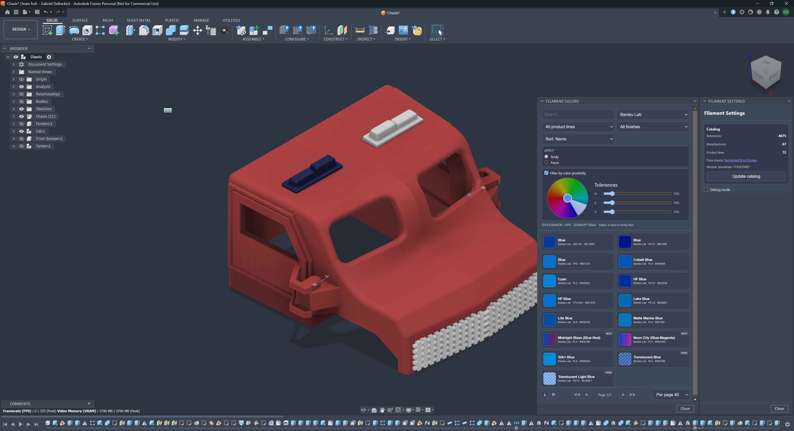
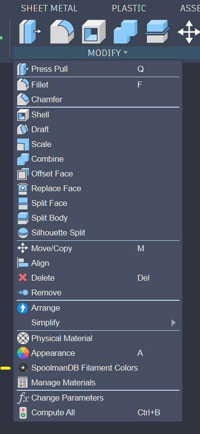
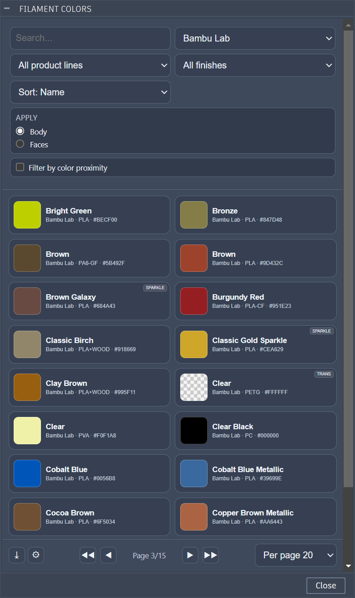
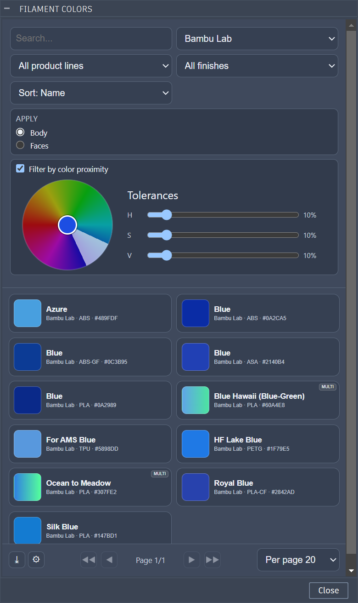

# Fusion Filament Colors

**Languages:** [English](README.md) · [Français](README.fr.md)

Community Autodesk Fusion add-in for applying filament-like appearances from a visual catalog.

> Unofficial project. Not affiliated with, endorsed by, or maintained by Autodesk or any filament manufacturer.

## What this add-in does

This add-in lets you browse a filament catalog in Fusion, pick a color swatch, and apply a generated appearance directly to selected geometry.

It is designed for fast iteration during concept/modeling workflows where you want color context without manually building appearances for each material.

## Features

- Visual filament catalog powered by SpoolmanDB
- 8,000+ references (depends on upstream catalog)
- Search by color/material text
- Filter by manufacturer, product line, finish
- Sort by name or color spectrum
- Color-proximity filtering with tolerance controls
- Special handling for translucent and multi-color entries
- Appearance generation based on copied Autodesk native appearances
- Apply scope aligned with common Fusion workflow:
  - **Body**
  - **Faces**
- Catalog caching with periodic refresh and manual refresh support
- Separate palettes for:
  - **Filament Colors** (browse/apply)
  - **Filament Export** (export actions)
  - **Filament Settings** (catalog + add-in controls)
- Export helpers for:
  - Parent Fusion archive (`*_PARENT.f3d`)
  - Single-file 3MF export (`*_PARENT.3mf`)
- Works on macOS and Windows

## Installation

1. Download or clone this repository.
2. Open Autodesk Fusion.
3. Go to `Utilities > Scripts and Add-Ins`.
4. Click `+`.
5. Choose `Script or add-in from device`.
6. Select this add-in folder.
7. Open the **Add-Ins** tab.
8. Select **SpoolmanDB Filament Colors**.
9. Click **Run**.

## Usage

1. Select one or more **faces** or **bodies**.
2. In the palette, choose **Apply: Body** or **Apply: Faces**.
3. Search/filter to the filament you want.
4. Click the swatch to apply.

Created appearances are named in this format:

```text
SpoolmanDB Filament | Manufacturer | Product Line | Color Name | #RRGGBB
```

## Catalog and data source

Catalog data is sourced from SpoolmanDB by Donkie:

- https://donkie.github.io/SpoolmanDB/
- https://donkie.github.io/SpoolmanDB/filaments.json

The add-in downloads and normalizes this dataset, then stores a local cache in `filament_catalog_cache.json`.

- Automatic refresh: up to once every 7 days
- Manual refresh: available in **Filament Settings**
- Offline behavior: falls back to cache when remote fetch fails

## Export notes

The export palette supports:

- `Project_PARENT.f3d`
- `Project_PARENT.3mf`

Use `.3mf` or `.f3d` when you need to preserve more appearance/color context than STL.

## Screenshots






## Upstream attribution

This project builds on the original work and ideas from:

- [GAb0222/BambuLab-Fusion-Filament-Colors](https://github.com/GAb0222/BambuLab-Fusion-Filament-Colors)

Many of the initial implementation concepts came from that upstream project. This repository is an independently maintained continuation/fork with additional workflow, UI, and architecture changes.

## Maintainer

Maintained by **Gabriel DeBacker**:

- GitHub: [GabeDeBacker](https://github.com/GabeDeBacker)

## License

This repository is distributed under the **MIT License**.  
See [LICENSE](LICENSE).

## Trademarks

- Autodesk and Fusion are trademarks of Autodesk, Inc.
- Filament brand names are trademarks of their respective owners.
